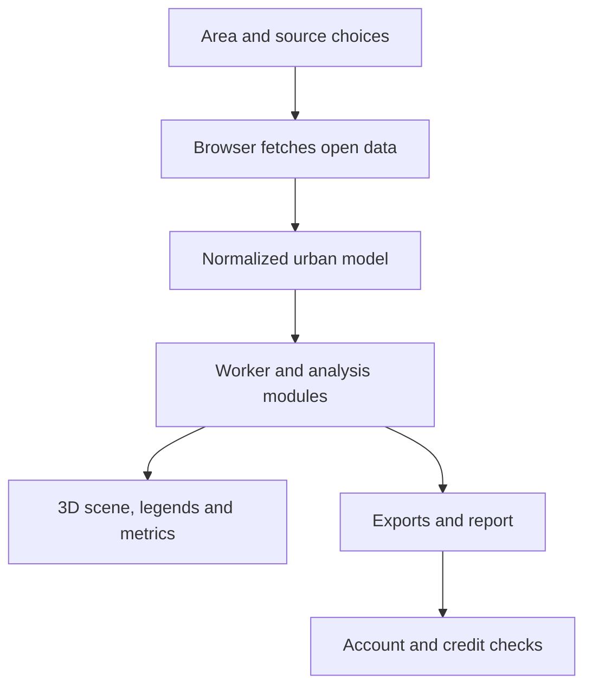

# urban:SCAN product and technical review

**Reviewed 3 November 2026.** Public product: https://urban-scan.ildar.space/. This is a study of a public interface, legal pages, and JavaScript served to visitors, plus one ordinary free analysis of a 0.25 km square in Manhattan. It is not access to private source, server configuration, accounts, payment records, or the correctness of every result. Site features and prices can change.

## Evidence and confidence

- **Observed in browser:** A dark introductory page; a map-based area selector; site/city scale; square/circle or uploaded boundary; optional data sources; analysis workspace; a 3D scene, legend, controls and exports. The Manhattan run reported 6.3 ha, 46 buildings, 440 residents and FAR 13.99. These are outputs of its model, not independently verified facts about Manhattan.
- **Observed in browser:** The height panel offers height, floors, height source and footprint source. The source legend in this run showed OSM height 76%, Overture 4.3%, WSF 3D estimate 6.5%, and typical-for-type 13%. The density panel offers FSI, GSI, dwellings, residents and jobs per hectare with a moving-window radius; its note identified Gaussian smoothing and dwelling assumptions. The percentages and labels are one run, not universal coverage.
- **Derived from publicly served client modules:** The page loads Leaflet and MapLibre. Its main JavaScript imports modules for geodata, terrain, imagery, a 3D scene, analyses, a Web Worker, exports, reporting, recording and billing. `data/osm.js` issues a broad site Overpass query with buffers for context and caches a successful response in the browser for 24 hours. `data/overture.js` reads the latest STAC release and tiled Overture PMTiles, uses a bounded pool, and also reads Microsoft Planetary Computer vector tiles. `analyses.js` declares analysis functions that return coloured buildings, grids, lines, points, legends and statistics. This shows what client code attempts; it does not prove all upstream providers or analyses work everywhere.
- **Published by provider:** Its terms say analysis viewing is free and paid credits cover exports; its privacy page says analyses run in the browser while map/data providers receive browser requests. A shared account, Paddle payments, Cloudflare hosting/database and Resend email are described. The server-side billing controls, entitlement checks and security are not inspectable here.

Sources: [main site](https://urban-scan.ildar.space/), [pricing](https://urban-scan.ildar.space/pricing), [terms](https://urban-scan.ildar.space/terms), [privacy](https://urban-scan.ildar.space/privacy). Public script paths inspected: `/js/app.js`, `/js/analyses.js`, `/js/data/osm.js`, `/js/data/overture.js`. No third-party implementation or assets were copied into Site Context Studio.

## What the visitor can do

| Stage | Publicly visible behavior | Our architectural reading |
|---|---|---|
| Discover | Hero communicates worldwide open-data urban analysis, categories and a path to the tool. | It sells the analytical question, not a raw file type. |
| Select place | Search location/coordinates, navigate a dark map or satellite view; site vs city scale; square/circle size; import KML/KMZ/GeoJSON polygon. Site interface advertised detail up to 20 km² at review time. | Choice of boundary and scale determines data budgets and resolution. The site/city modes can require different models. |
| Choose inputs | OSM, Overture, Microsoft footprints, WSF, Overture places and optional tree detection appear as source switches. | Cross-source deduplication and attribution are core engineering, not a cosmetic layer toggle. |
| Build model | UI shows loading terrain and map data before an analysis workspace. Public client code fetches multiple sources and prepares an inventory and grid. | One normalized model is reused by many analyses. Context outside the exact site is gathered for network/environment computations. |
| Explore | Left rail groups Form, Use and people, Movement, Environment. Center shows an orbitable 3D scene with a title, legend, points, colour ramp and summary. | A single result contract can drive several views and exports. A map by itself does not communicate a method. |
| Adjust | Submodes and parameters include height source, density radius, 3D building/road/green layers, labels, grid and vertical exaggeration. | Parameter changes should record their inputs and recompute only affected results. |
| Project | Visible controls for existing/project/difference, drawing volumes, removing buildings and importing own layers. | Thesis users benefit from before/after comparison, but the baseline must remain immutable. |
| Export | Visible DXF, GeoTIFF, GeoJSON, CSV, PNG, GLB, KMZ, PDF, video and graphics editor options; availability depends on analysis and account. | A package/report should attach model method, data release, source rights and assumptions. |
| Pay | Free interactive exploration; credits for most downloads, with a free small-site PNG exception. A paid result can be downloaded again for the same site under its published policy. | Monetize a reliable, reusable deliverable after data quality, rights and operational costs are proven. |

At review time the pricing page listed packs of 10/$5, 30/$12, 100/$30 and 200/$50. Basic site data and many individual analysis exports were 1 credit; access/syntax/visibility/heat analyses and video were typically 2; sun/noise/solar/flows were 3; wind and rain were 5; the combined PDF report was 8. The base price applied to sites up to 5 km²; larger sites up to 20 km² multiplied analysis credits by area, rounded up. These are published product prices, not a cost or pricing recommendation for our service.

The modules advertised include heights, age, built density, blocks/Spacematrix, street canyons, visibility, view corridors; land use, places, population/jobs, housing value, access, public spaces and walkability; street syntax, pedestrian/car flows, transit, cycling, isochrones and parking; sun/shadows, wind, noise, rain, trees, heat and solar roofs. This is a **menu of visible capabilities**, not a claim that each has accurate global coverage. Some data are regional or coarse, and simulation outputs are estimates by the provider's own terms.

## How it appears to be built

The diagram combines observed UI, publicly served client modules and published privacy/pricing descriptions. It is an architectural interpretation, not a server trace. The client imports a worker for expensive computations and caches a model's analysis results by scenario version. The OSM module uses the Cache API keyed by a hash of the query. Overture's PMTiles fetch offers a different access path from downloading whole GeoParquet files. Errors in a pooled Overture tile read can yield a null tile, so completeness reporting matters. I did not inspect private server code or test an export/payment flow.

## Fit for Site Context Studio

| Idea | Value to an architecture student | Current state / decision |
|---|---|---|
| One boundary, many analyses | Avoid repeated QGIS setup and keep a consistent study area. | Our persistent Overture capture already supports this. Add analyses as separate modules tied to a capture ID. |
| Source confidence map | Make invented and inferred height visible before design decisions. | **Implemented in 0.1.11:** Form / Height evidence readout and thematic footprint map. |
| Assumptions beside result | Prevent a clear-looking graphic from implying survey-grade precision. | Added explicit height categories and limitations to the result and ZIP. Keep this rule for every future module. |
| Terrain and orbitable context | Explain terrain and building massing to non-GIS users. | **0.1.12:** integrated 3D site workspace with captured buildings, roads, water, land use, optional terrain and layer visibility. Browser visual verification remains. |
| Source blending | Increase coverage in Pune and other regions. | Research source terms and implement geometry deduplication with per-feature provenance before offering a source switch. Do not treat OSM and Overture as independent complete copies. |
| Density / FAR | Valuable thesis site analysis. | Delay until footprints are clipped to AOI and floor data are validated. Present observed, estimated and unknown denominators separately. |
| Network access | Strong early next module for roads, services and walkability. | **0.1.12:** clipped mapped road length by kind is a first Movement readout. Topology, POIs, routing assumptions and source coverage remain necessary for access claims. |
| Sun and thermal | Useful for massing scenarios. | Use true solar geometry first with explicit date/time and coordinate system; do not claim wind/heat precision from terrain alone. |
| Project comparisons | Make the tool a design instrument rather than one-time extraction. | Preserve an immutable existing-site capture and store scenario operations separately; compare the same metric contract. |
| Free exploration, paid export | Let students assess value before payment. | Do after reliability, source licences, server cost, privacy and account isolation are tested. No payment feature is claimed now. |

### Recommended next technical sequence

1. **Trust and geometry:** polygon clipping, invalid geometry repair with documented rules, source coverage indicators, and unit validation on 3 different Indian cities against GIS/field references.
2. **Form:** expand the Height evidence module into building height distributions and valid clipped GSI/FSI only where floor attributes support them. Unknown heights stay unknown unless a named scenario is explicitly enabled.
3. **Movement:** road graph with connectivity and accessible services from separately licensed POI data; document walking assumptions and disconnected links.
4. **Environment:** solar/shadow analysis against georeferenced terrain and validated building heights, then tree/green coverage where source imagery and licences permit.
5. **Project:** store editable scenario actions and compute before/after differences against the same pinned capture. Export each analysis result with source, method, parameters, timestamp, limitations and raw data links.
6. **Production:** user accounts, private storage, queued bounded jobs, per-user budgets, failure recovery, metered hosting, security review and billing only when legally usable data and the actual cost per capture are known.

### Design lesson

Keep our existing Urbanist map-first visual language. Add a clear analysis selector and a result card with a large value, a compact legend, source provenance and an action to inspect the map. Use motion for state changes (capture progress, selecting a view, before/after), respect reduced-motion preferences, and keep analytical colours consistent between 2D and 3D. This is a product pattern inspired by the workflow, not a reproduction of its brand, layout, colours, text, illustration or code.

## Accuracy, rights and unknowns

- A published Overture release is current as a dataset, not live ground truth. Neither product can guarantee perfect buildings everywhere.
- The example density panel displayed population, jobs and FAR, but I did not verify its source values or calculations independently. Do not use its numbers as design regulations or survey data.
- WSF, Sentinel, Landsat and ERA5 have different resolutions and histories; city-scale or thermal estimates cannot be treated as building-by-building observations.
- Public website JavaScript is viewable but no open-source licence was found on the inspected site. Reuse of code, design assets, branding, datasets, or tile imagery is not assumed. Its terms disallow automated payment bypass, overload and resale of access. This review performed one small normal free analysis and inspected public assets; it did not attempt paid exports.
- We have not observed its private backend, authentication checks, payment security, operational costs or all feature branches. Their implementation and reliability are unknown.
